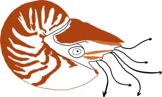
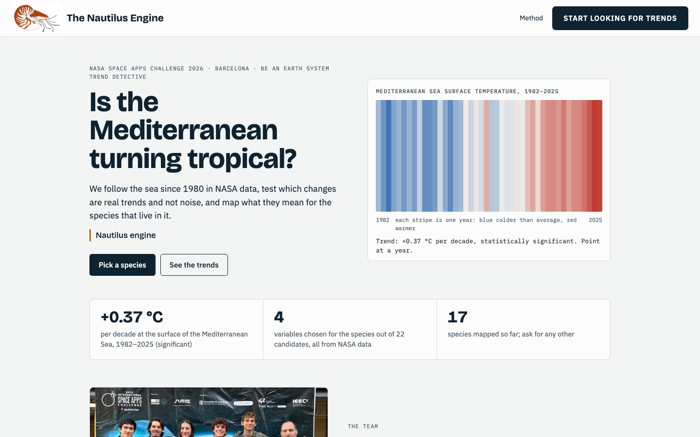
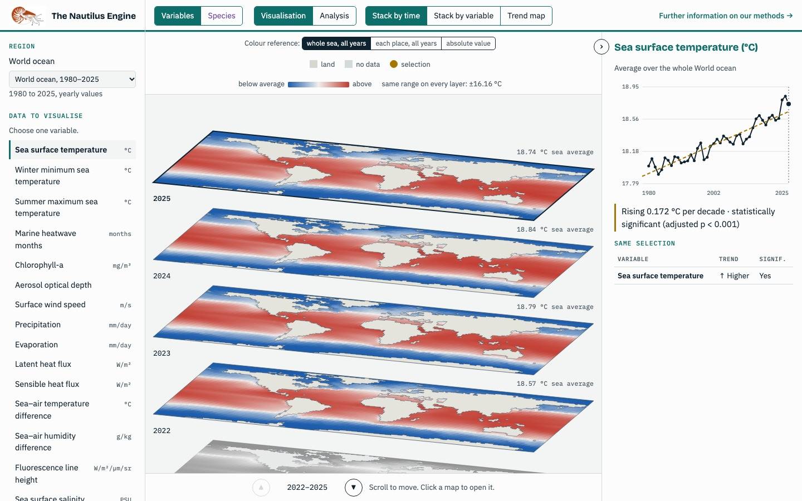
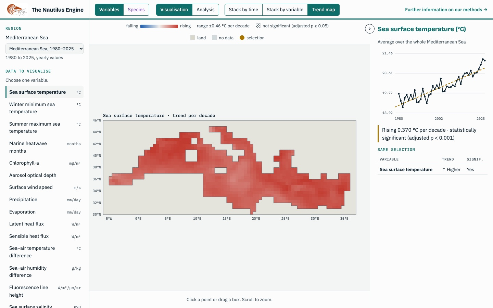
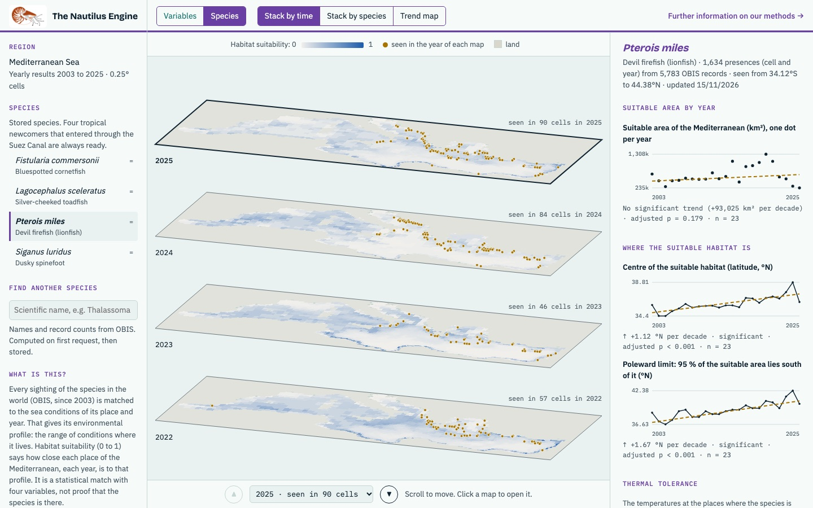

<p align="center">
  
</p>

<h1 align="center">The Nautilus Engine</h1>

<p align="center">
  <b>Is the Mediterranean turning tropical?</b><br>
  We follow the sea since 1980 in NASA data, test which changes are real trends and not noise,
  and map what they mean for the species that live in it.
</p>

<p align="center">
  <a href="https://trend.cooking"></a>
</p>

<h3 align="center"><a href="https://trend.cooking">https://trend.cooking</a></h3>

<p align="center">
  NASA Space Apps Challenge 2026 · Barcelona · challenge
  <a href="https://www.spaceappschallenge.org/"><i>Be an Earth System Trend Detective!</i></a>
</p>

<p align="center">
  <a href="https://trend.cooking"></a>
</p>

| Variables: maps stacked by year | Trend map: where the Mediterranean warms | Species: habitat and sightings by year |
|---|---|---|
| [](https://trend.cooking/explore.html) | [](https://trend.cooking/explore.html?datos=mediterraneo-1980) | [](https://trend.cooking/explore.html#species) |

---

## What it does

The site has three parts, all reachable from the start page.

| Part | Question it answers | What you can do |
|---|---|---|
| **Variables** | What is changing in the sea, where, and how much? | 15 variables for the **world ocean** or the **Mediterranean**, 1980–2025, as maps stacked by year or by variable, a trend map (hatched where the trend is not significant), and an Analysis screen with time series, correlations between variables and a two-variable correlation map. Click a point or drag a box to get the trend of that place. |
| **Species** | Where can a species live, and is that changing? | Four tropical fish that entered the Mediterranean through the Suez Canal are always ready (2003–2025, four variables) (*Pterois miles*, *Lagocephalus sceleratus*, *Siganus luridus*, *Fistularia commersonii*); any other marine species can be searched and is computed on request. Habitat suitability year by year with the sightings, the trend map of suitability, suitable area, centre and poleward limit of the habitat, thermal tolerance, limiting factors, and a map that combines the habitat trend with how much the sea around it has changed. |
| **Method** | Why these four species variables? | The article on how 22 candidate variables were reduced to four, with every figure reproducible. |

## What we found

Trends for the whole Mediterranean (cosine-weighted mean of 1,009 sea cells of 0.5°), Sen's slope
per decade, significance by the modified Mann-Kendall test:

| Variable | Trend per decade | Significant? |
|---|---|---|
| Sea surface temperature (1982–2025) | **+0.37 °C** | yes (adjusted p < 0.001) |
| Summer maximum sea temperature | **+0.42 °C** | yes (adjusted p < 0.001) |
| Winter minimum sea temperature | **+0.24 °C** | yes (adjusted p < 0.001) |
| Marine heatwave months | **+1.9 months per year** | yes (adjusted p < 0.001) |
| Chlorophyll-a (2003–2025) | −0.015 mg/m³ | no (adjusted p = 0.12) |

For comparison, the world ocean warmed by +0.17 °C per decade over the same years: the
Mediterranean is warming about twice as fast.

For the four species that arrived through the Suez Canal, suitability is computed with the four
variables (coldest month, hottest month, unusually hot months, chlorophyll), 2003–2025. Over these
23 years the total suitable area of the Mediterranean shows no significant trend for any of them:

| Species | Suitable area trend per decade | Adjusted p |
|---|---|---|
| *Fistularia commersonii* (bluespotted cornetfish) | +183,959 km² | 0.21 |
| *Pterois miles* (devil firefish, lionfish) | +93,025 km² | 0.18 |
| *Siganus luridus* (dusky spinefoot) | −68,057 km² | 0.82 |
| *Lagocephalus sceleratus* (silver-cheeked toadfish) | −111,588 km² | 0.63 |

Where the suitable habitat lies does move: for *Pterois miles*, its centre moves north by 1.12° of
latitude per decade and its poleward limit by 1.67° per decade (both adjusted p < 0.001).

These numbers are computed by the code in this repository from the data below and refresh every
day; the site always shows the current values.

## Data

All environmental data are from NASA, except sea surface temperature (NOAA). Species sightings are
from OBIS.

| Data | Source | Used for | Since |
|---|---|---|---|
| Surface skin temperature, air temperature, humidity, heat fluxes, evaporation, precipitation, wind | **NASA MERRA-2** monthly (GES DISC, OPeNDAP: M2TMNXSLV, M2TMNXFLX) | Variables; species temperature model | 1980 |
| Aerosol optical depth | **NASA MERRA-2** monthly (M2TMNXAER) | Variables | 1980 |
| Chlorophyll-a, fluorescence line height | **NASA MODIS-Aqua** monthly (served by NOAA CoastWatch ERDDAP) | Variables; species model | 2003 |
| Sea surface salinity | **NASA SMAP** RSS v6 monthly (PO.DAAC, OPeNDAP) | Variables | 2015 |
| Sea surface temperature | NOAA OISST v2.1 monthly | Variables (temperature, winter minimum, summer maximum, marine heatwave months) | 1981-09 |
| Species sightings | [OBIS](https://obis.org/), Ocean Biodiversity Information System | Species | 1980 |

Grids: 1° world grid for most variables, 0.5° for sea temperature and chlorophyll, 0.25° for the
species habitat. The Variables page shows the Mediterranean at 0.5° and the world ocean at 2°.

## Method

- **Yearly values:** monthly means averaged per year; a year counts in a cell only with enough
  months of data.
- **Trend:** Sen's slope (median of the slopes between every pair of years).
- **Significance:** modified Mann-Kendall test (Hamed and Rao, 1998), which corrects for one year
  resembling the next.
- **Many tests at once:** p-values of the cells of a map, or of the indicators of a species, are
  adjusted together with the Benjamini-Hochberg false discovery rate. "Significant" means
  adjusted p < 0.05.
- **Habitat suitability (0 to 1):** every OBIS sighting since 1980 is matched to the sea
  conditions of its place and year (coldest month, hottest month, unusually hot months,
  chlorophyll). That gives the species' environmental profile. Each Mediterranean cell and year is
  scored by how close it is to that profile (an environmental envelope, BIOCLIM type); the
  variable that limits it most is the limiting factor.
- **Forecast** (Analysis screen): 5-year damped exponential smoothing with a 90 % prediction
  interval (Darts).

The same trend method is used in the backend (`backend/tendencias.py`) and in the browser for
selections drawn on the map (`trend-detective/stats.js`).

## Limits

- Habitat suitability is a statistical match with four variables, not proof that a species is
  present or absent.
- OBIS sightings depend on where and when people looked; the observed indicators are computed on
  samples of equal size per period to reduce that effect, but cannot remove it.
- MERRA-2 temperature is surface skin temperature from a reanalysis; over the sea it is close to
  sea surface temperature, at a coarser resolution than satellite products.
- Chlorophyll starts in 2003 and salinity in 2015 (satellites); their trends cover only those years.
- A few months are missing when a data server failed during a download; they are filled on the
  next daily run.

## How it is built

```
NASA MERRA-2, SMAP ─┐
NOAA OISST ─────────┼─► backend/recolector.py ─► Zarr stores ─► backend/api.py (FastAPI) ─► trend-detective/ (static site)
MODIS (ERDDAP) ─────┘   (runs daily)                  ▲
OBIS sightings ───────► backend/especies_habitat.py ──┘
```

| Folder | What it is |
|---|---|
| [`trend-detective/`](trend-detective/) | The website: start page, explorer (Variables and Species) and method article. Plain HTML, CSS and JavaScript, no build step. Details in its README. |
| [`backend/`](backend/) | Data harvester, species habitat model, trend export and FastAPI service; deployment files in `backend/despliegue/`. Docs in English and Spanish. |
| [`trend-detective/methodology/`](trend-detective/methodology/) | The variable-selection study behind the Method page: text, figures, results and scripts (`run_all.sh`). |
| [`notebooks/`](notebooks/) | Exploratory scripts (species info, Giovanni API calls). |
| [`tools/earthdata-auth/`](tools/earthdata-auth/) | Scripts that create local NASA Earthdata credentials. |

### Run it locally

Backend (needs a NASA Earthdata token in `EARTHDATA_TOKEN` to download data):

```bash
cd backend
python3 -m venv .venv && .venv/bin/pip install -r requirements.txt
.venv/bin/python recolector.py          # first load: downloads the monthly data
.venv/bin/uvicorn api:app --reload      # API on http://127.0.0.1:8000 (docs at /docs)
```

Website only, with the static Mediterranean files in `trend-detective/data/` (no backend needed):

```bash
cd trend-detective
python3 -m http.server 8000
# open http://localhost:8000/explore.html?datos=ficheros
```

Server set-up (systemd services, daily timer, nginx) is described in
[`backend/README.md`](backend/README.md).

## Use of AI

Generative AI coding assistants were used to write and review much of the code (backend, website,
analysis scripts) and to draft documentation and site texts, from the team's design, data choices
and decisions. All numbers shown on the site and in this README are computed by the code in this
repository from the data sources listed above.

## Team

NASA Space Apps Challenge 2026, Barcelona. <!-- Team members and roles: to be completed by the team. -->

With thanks to Joan Pino, director of CREAF.
