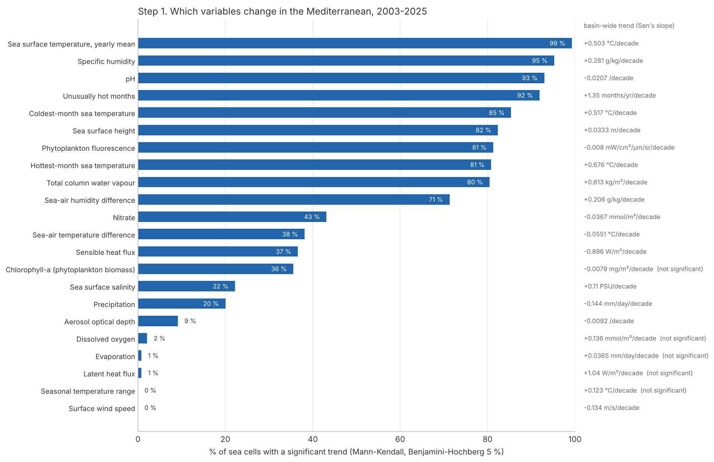
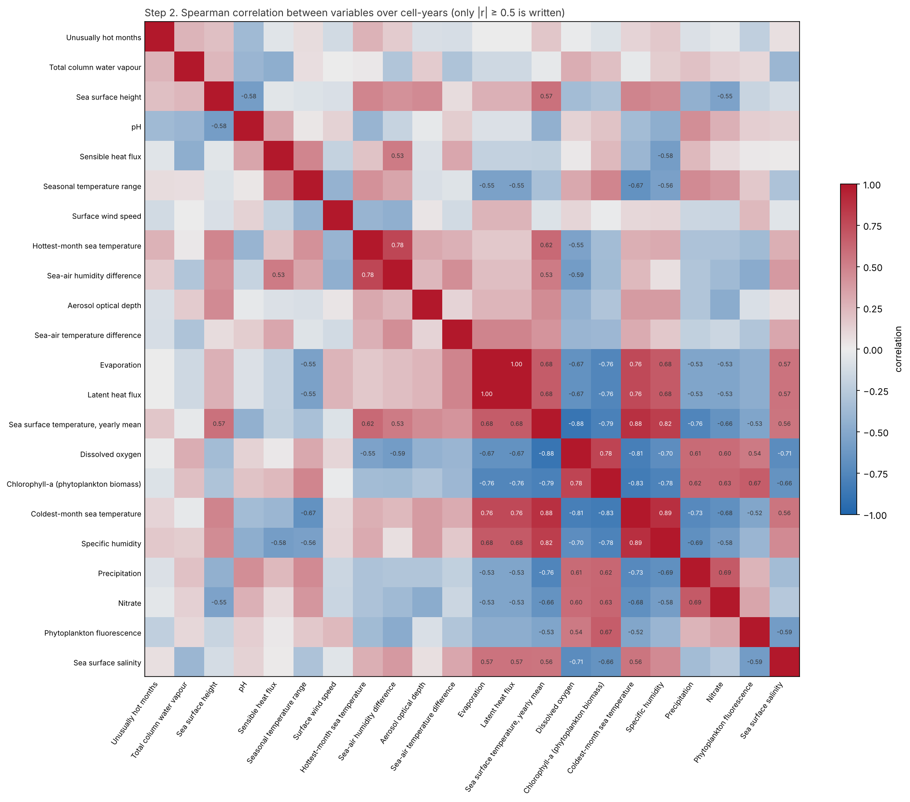
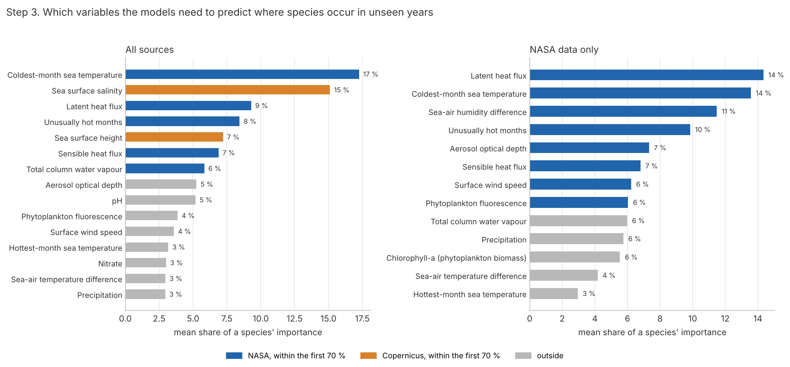
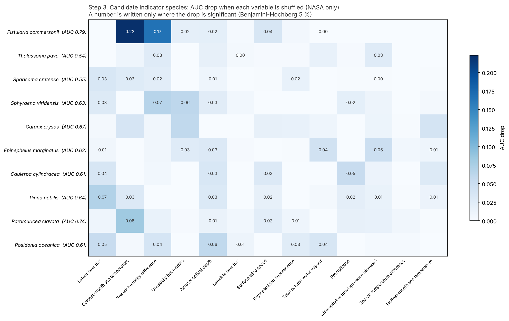
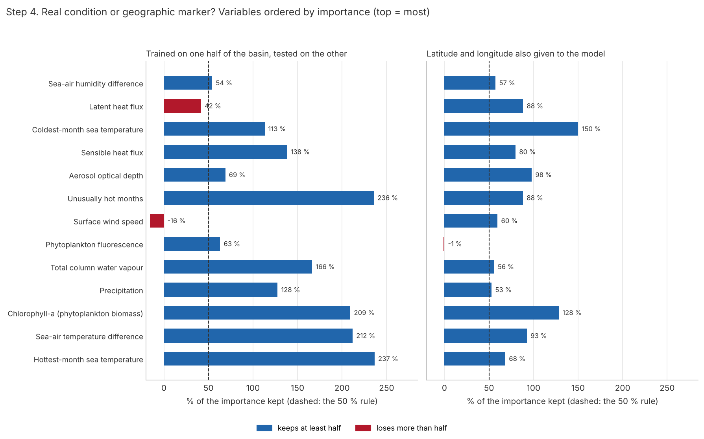
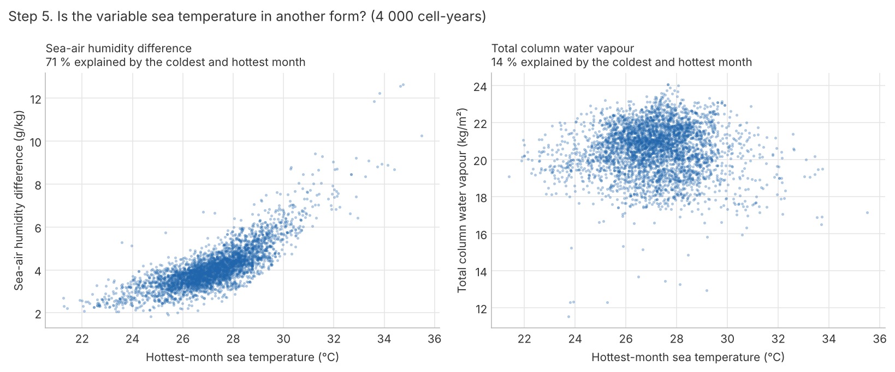

# How we chose the variables

Argumentation written with SI assistance. (see [Reproduce](#reproduce)).

## Result

We started from 22 candidate environmental variables and kept four, all from NASA data:

| Variable | id | Source | Basin trend per decade | Sea cells with a significant trend |
|---|---|---|---|---|---|
| Coldest-month sea temperature | `sst_winter_min` | NASA MERRA-2 | +0.52 °C | 85 % | 
| Unusually hot months | `mhw_months` | NASA MERRA-2 | +1.35 months | 92 % |
| Hottest-month sea temperature | `sst_summer_max` | NASA MERRA-2 | +0.68 °C | 81 % |
| Chlorophyll-a | `chl` | NASA MODIS-Aqua | −0.008 mg/m³ (not significant) | 36 % |

The first two are supported by every test we ran. The last two are a decision of the team
based on biology aspects, despite their performance on the test. The tests do not contradict them, but they do not single them out either.
[What is solid and what is judgement](#what-is-solid-and-what-is-judgement)

The focus of this study is the Mediterranean Sea, and so the variable candidate method is conducted strictly there. We assume the selected region to be representative of the global data.

Data: Mediterranean Sea, 0.5° cells (1 094 sea cells), yearly values 2003–2025 (23 years).
Species: 140 813 OBIS records of 1 112 species.

## The question behind the method

A variable can be useful for two different jobs, and they need different evidence:

- **Explaining change.** If a species appears where it was absent, the cause must be something
  that changed. A variable with no trend cannot be that cause, however well it predicts where
  the species lives today.
- **Defining the Enviromental Suitability Area (ESA).** Where a species can live is the overlap of all its conditions, changing
  or not. A constant condition still rules places out, and it cannot create a false trend,
  because its contribution to any change over time is zero.

THis way, we don't automatically drop a variable for not changing significantly. The danger is different: a variable
that is only a **geographic marker**. If the model learns "this species lives where there is
Saharan dust" and dust does not change, the predicted habitat stays in the south forever and
hides the new habitat that warming opens in the north. We implemented a methodology to discern conditions from markers.

## The candidate variables

| id | Full name | What it is | Source |
|---|---|---|---|
| `sst` | Sea surface temperature, yearly mean | Mean of the 12 months | NASA MERRA-2 (M2TMNXSLV, TS) |
| `sst_winter_min` | Coldest-month sea temperature | Minimum of the 12 months | derived from the same |
| `sst_summer_max` | Hottest-month sea temperature | Maximum of the 12 months | derived |
| `sst_range` | Seasonal temperature range | Hottest month minus coldest month | derived |
| `mhw_months` | Unusually hot months | Months of the year above the 90th percentile of that calendar month over 2003–2025. A monthly stand-in for marine heatwaves | derived |
| `dt_sea_air` | Sea-air temperature difference | Sea surface temperature minus air temperature at 2 m | NASA MERRA-2 (TS, T2M) |
| `chl` | Chlorophyll-a | Phytoplankton pigment concentration: phytoplankton biomass | NASA MODIS-Aqua |
| `nflh` | Phytoplankton fluorescence | Light emitted by chlorophyll | NASA MODIS-Aqua |
| `lhf` | Latent heat flux | Heat the sea loses by evaporating water | NASA MERRA-2 (M2TMNXFLX) |
| `shf` | Sensible heat flux | Heat passing from sea to air by contact | NASA MERRA-2 |
| `evap` | Evaporation | Water passing from sea to air | NASA MERRA-2 |
| `precip` | Precipitation | Rain over the sea | NASA MERRA-2 |
| `wind` | Surface wind speed | | NASA MERRA-2 |
| `q2m` | Specific humidity | Water vapour in the air at 2 m | NASA MERRA-2 |
| `dq_sea_air` | Sea-air humidity difference | Saturation humidity at the sea temperature minus the humidity of the air | NASA MERRA-2 |
| `tqv` | Total column water vapour | All the water vapour in the air column | NASA MERRA-2 |
| `aod` | Aerosol optical depth | Dust and particles in the air | NASA MERRA-2 (M2TMNXAER) |
| `sss` | Sea surface salinity | | Copernicus Marine model |
| `ssh` | Sea surface height | | Copernicus Marine model |
| `ph` | pH | | Copernicus Marine model |
| `o2` | Dissolved oxygen | | Copernicus Marine model |
| `no3` | Nitrate | Stands in for the "nitrogen concentration" of the original list | Copernicus Marine model |

NASA's SMAP salinity alternative wasn't used because of its short data series (2015-2025)

## Method, step by step

| Step | Question | Technique |
|---|---|---|
| 1 | Does the variable change? | Sen's slope (Theil–Sen estimator); Mann–Kendall trend test; Benjamini–Hochberg false discovery rate correction across cells |
| 2 | Does it carry information no other variable carries? | Spearman rank correlation; agglomerative hierarchical clustering (average linkage, distance 1 − \|r\|, cut at \|r\| ≥ 0.8); variance inflation factor (VIF ≤ 10); principal component analysis (PCA) as a description |
| 3 | Does it help predict where species occur? | Presence–background species distribution model with target-group background; logistic regression with linear and quadratic terms (L2 penalty, balanced classes); temporal hold-out validation; area under the ROC curve (Mann–Whitney U); permutation importance; permutation test of the model; Benjamini–Hochberg correction |
| 4 | Is it a real condition or a geographic marker? | Spatial block (transfer) validation, west to east and east to west; the same model with latitude and longitude added as predictors |
| 5 | Is it another variable in disguise? | Ordinary least squares with quadratic terms: R² of the variable against the coldest and hottest month |
| 6 | Final choice | Biological and physical informed choices |

### Step 1. Trends

For each variable and each sea cell, the 23 yearly values give a Sen's slope (how much it
changes) and a Mann–Kendall p-value (whether the change can be told from noise). Testing
1 094 cells would give about 55 false positives at 5 %, so the p-values are corrected with
Benjamini–Hochberg. The same is done for the mean of the whole basin.



- The sea warms everywhere and all year: +0.50 °C per decade on the yearly mean, significant in 99 % of cells.
- Summer warms slightly faster than winter (+0.68 against +0.52 °C per decade), but not enough for the seasonal range to have a trend of its own.
- Unusually hot months are the strongest change: +1.35 months per decade.
- Wind, evaporation and latent heat flux show no trend (0–1 % of cells).

### Step 2. Redundancy

Pairwise correlation is carried for all variables using PCA and VIF to drop redundant variables that can be explained by one, or a combination of multiple other variables.



| Removed | Because of | Evidence |
|---|---|---|
| Evaporation | Latent heat flux | r = +1.00, the same quantity in other units |
| Dissolved oxygen | Yearly mean temperature | r = −0.88 |
| Specific humidity | Coldest-month temperature | r = +0.89 |
| Seasonal range | Hottest and coldest month | VIF above 100 000: it is exactly their difference |
| Yearly mean temperature | Hottest and coldest month | VIF 32 |

Chlorophyll-a correlates at r = −0.83 with the
coldest month: its independence is borderline, given that it indicates the presence of organic life (also subject to temperature changes).

### Step 3. Relevance for species

Records come from OBIS: 42 relevant (most observed or commonly seen) species are modelled.

For each species:

1. **Presences**: the cell-years where it was recorded, each paired with the variables of that cell and year.
2. **Background**: cell-years where any other species was recorded but not this one (target-group background). This compares against places where somebody was looking, so the model does not learn where the divers are.
3. **Model**: logistic regression on each standardised variable and its square. The square lets the response have an optimum, which is what a niche is.
4. **Temporal validation**: trained on years before 2017, scored on 2017–2025 with the AUC: the probability that a random presence scores higher than a random background point (0.5 is chance).
5. **Permutation importance**: one variable is shuffled in the test years and the AUC drop is measured, 100 times.
6. **Control**: the AUC is compared with 100 runs with shuffled labels. Species that do not beat chance are left out.

Significance alone was useless here: with thousands of records, every one of the variables
came out significant for some species. Variables are therefore ranked by **share of
importance**: a variable's AUC drop divided by the sum of drops for that species, averaged
over species.





- 35 species have a valid model. Median AUC is 0.62–0.64: better than chance, weak but still good given the complexity of the biological processes involved.
- The coldest month is first or second in both runs.

### Step 4. Real condition or geographic marker

Two tests on the 13 NASA variables and the 34 species whose model scores above 0.55:

- **Across the basin**: train on the western half of each species' records, test on the eastern half, and the reverse. A physiological limit holds on both sides; a marker learnt in the west says nothing in the east.
- **With coordinates**: repeat step 3 giving latitude and longitude to the model. A variable that only stood in for position (markers) loses its importance.

By convention: a variable passes if it keeps at least half of
its importance in both tests.



- **Latent heat flux, wind and fluorescence.** Markers: fluorescence loses all its importance once position is known, and wind makes prediction worse on the other side of the basin.
- **Aerosols pass.** We suspected them of being a marker but the test does not support that.
- **The coldest month is the only large variable that gains importance in both tests.**
- Sea-air humidity difference passes narrowly (54 % and 57 %).

### Step 5. Humidity and water vapour

Five variables pass step 4 and also have a trend in at least half of the cells: coldest
month, hottest month, unusually hot months, sea-air humidity difference and total column
water vapour. The last two need a physical look.



- **Sea-air humidity difference is sea temperature in another form.** It is the saturation humidity at the sea surface temperature minus the humidity of the air, and saturation humidity grows exponentially with temperature (about 7 % per degree). 71 % of its variance is explained by the coldest and hottest month, and its correlation with the hottest month is 0.78, just under the 0.8 cut of step 2. In a five-variable model that includes it the hottest month has an importance of 0.010; in a four-variable model without it, 0.028. They share one signal. A submerged organism does not feel air humidity, so the direct variable is the temperature.
- **Total column water vapour is independent of sea temperature** (14 % explained), but it is a property of the air mass above the sea. We find no pathway by which it would act on a marine organism. Its trend is the atmosphere warming.

## What is solid and what is judgement

**Solid.** Coldest-month temperature and unusually hot months: among the most important
variables, strong trends, pass both transfer tests in every set, and have a clear mechanism.
Winter cold is the filter that decides whether a warm-water species can stay; heat extremes
cause die-offs.

**Solid, as exclusions.** Latent heat flux, wind and fluorescence are geographic markers.
Yearly mean temperature, seasonal range, specific humidity and evaporation are redundant.

**Judgement.**

- *Hottest-month temperature is kept.* It is the upper thermal limit of heat-sensitive species (Posidonia, the noble pen shell, gorgonians), it has a strong trend, and it passes the transfer rule in three sets of four. Against it: lowest importance of all 13. A likely reason for the low importance is that summer is hot everywhere in the Mediterranean, so it separates places less than winter does, and that its effects are die-off events a yearly presence model does not capture.
- *Chlorophyll-a is kept.* It is the only measure of food supply and the only final variable observed directly by satellite rather than taken from a reanalysis. It passes the transfer rule in two sets of three. Against it: no significant basin trend, r = −0.83 with the coldest month. It is in the habitat model as a condition, not as a driver of change.
- *Sea-air humidity difference and total column water vapour are dropped* although they pass the rule in the 13-variable set, for the reasons of step 5.
- *Aerosols, sensible heat flux, precipitation and sea-air temperature difference are dropped* although they pass the transfer tests: weak or no trend, no direct mechanism, and we want the smallest, simplest set. Being constant or nearly so, they could be added to the habitat model later without creating false trends.

The thresholds (|r| ≥ 0.8, VIF ≤ 10, 70 % of the importance, half of the importance kept,
half of the cells) are conventions chosen by the team.

Different species depending on different variables is expected, not a problem. The store
holds the common set and each species weights it.

## Limitations

- 23 years is short for climate trends. The period starts in 2003 because MODIS does.
- The Mann–Kendall test used is the plain one, without correction for autocorrelation between years. The web tool applies the modified Man-Kendall and FDR correction.
- Species models are weak (median AUC about 0.63).
- Only the Mediterranean: each species' niche is cut to local conditions. Acceptable for choosing variables, not for the final habitat profile, which needs the species' world range.
- OBIS records grow from about 3 000 a year before 2018 to 23 000 in 2025, so test years hold far more data than training years.
- The download of bony fishes stopped at the 400 000-record cap.
- 0.5° cells (about 50 km) mix very different coastal conditions.
- Sea temperature is the skin temperature of a reanalysis (MERRA-2), not a direct satellite measurement.
- Unusually hot months are not marine heatwaves in the standard sense, which is defined on daily data.
- The study shows which variables help prediction. It does not show cause.

## Reproduce

From the GitHub repo:

```bash
pip install numpy pandas scipy scikit-learn matplotlib
bash run_all.sh        # about two minutes
```

| Script | Step | Writes |
|---|---|---|
| `scripts/study_variables.py` | 1, 2, 3 | `results/<run>/report.md`, `trends.csv`, `correlation_*.csv`, `species_relevance.csv`, `species_variable_summary.csv` |
| `scripts/transfer_test.py` | 4, 5 | `results/nasa_only/transfer_summary.csv`, `transfer_by_species.csv`, `explained_by_temperature.csv` |
| `scripts/transfer_test.py --sets` | 6 | `results/nasa_only/transfer_sets.csv` |
| `scripts/make_figures.py` | figures | `figures/fig1…fig8.png`, `results/summary.json` |

Fixed settings: random seed 0; 100 permutations in step 3 and 60 in step 4; at least 30
presences per species; the 40 species with most records plus the indicators; temporal split
at 2017. With the same data the numbers are identical on every run.

To rebuild the inputs: `scripts/standalone_fetch.py` (NASA Earthdata token and Copernicus
Marine account) then `scripts/merge_npz.py` for `data/*.json`, and `scripts/fetch_obis.py`
for `data/obis.csv.gz`. OBIS grows daily, so a new download changes the numbers slightly.

The team's decision and reason for each variable are the `DECISION` table in
`scripts/make_figures.py`.

## Data sources

- NASA MERRA-2 monthly means (M2TMNXSLV, M2TMNXFLX, M2TMNXAER), GES DISC: https://disc.gsfc.nasa.gov/
- NASA MODIS-Aqua chlorophyll-a and fluorescence, served by NOAA CoastWatch ERDDAP: https://coastwatch.pfeg.noaa.gov/erddap/
- OBIS, Ocean Biodiversity Information System: https://obis.org/
- Copernicus Marine global physics and biogeochemistry models, for comparison only: https://data.marine.copernicus.eu/
